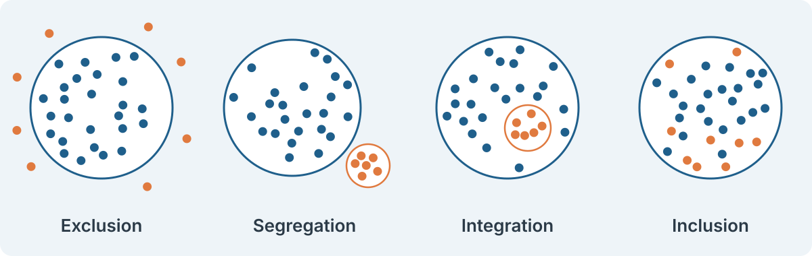

# Welcome {.unnumbered}

::: {.oth-frame}
{.welcome-banner fig-alt="Four circles showing exclusion, segregation, integration and inclusion: green dots outside the circle, in a separate circle, in a small circle inside, and finally mixed with all other dots."}
:::

Who belongs, who takes part, and on whose terms? In the seminar *International Perspectives on Inclusion and Exclusion*, we look at how societies draw these boundaries in schools, labour markets, citizenship law and social services, and how they do so differently from country to country.

This script accompanies the seminar. Here you will not only read: you will match, classify and recall. Take your time, try things out, and come back whenever you like.

## How to use this script

Work through the four pages in this order. You can also reach them through the menu on the left.

::: {.grid .welcome-cards}

::: {.g-col-12 .g-col-md-6 .welcome-card}
[]{.bi .bi-journal-text .welcome-icon}

**1 · [Key Terms](01-key-terms.qmd)**

Fourteen central terms and the confusions that often come with them.
:::

::: {.g-col-12 .g-col-md-6 .welcome-card}
[]{.bi .bi-lightbulb .welcome-icon}

**2 · [Theories and Concepts](02-theories.qmd)**

The theoretical approaches behind the terms.
:::

::: {.g-col-12 .g-col-md-6 .welcome-card}
[]{.bi .bi-controller .welcome-icon}

**3 · [Learning Games](03-learning-games.qmd)**

A memory game and eight international cases to classify. About 20 minutes.
:::

::: {.g-col-12 .g-col-md-6 .welcome-card}
[]{.bi .bi-check2-circle .welcome-icon}

**4 · [Learning Check](04-learning-check.qmd)**

A short test of what you have retained.
:::

:::

## Transparency note

AI was used to program the learning games, to draft questions and explanations, and to create the illustration on this page. All content has been reviewed by the author, who is responsible for it.
