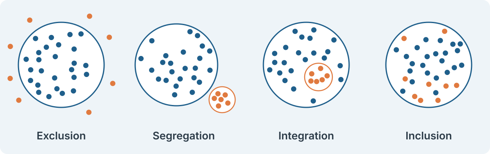

# Welcome {.unnumbered}

::: {.oth-frame}
{.welcome-banner fig-alt="Four circles showing exclusion, segregation, integration and inclusion: green dots outside the circle, in a separate circle, in a small circle inside, and finally mixed with all other dots."}
:::

Who belongs, who takes part, and on whose terms? This course examines global inequalities, power relations and structural mechanisms that shape inclusion and exclusion, from global justice and postcolonialism to migration, welfare systems, climate change and digital transformation.

## Course goals

After this course, you will be able to

1. **explain** and critically reflect on international theories of inclusion, exclusion and global inequality,
2. **analyse** the social, political, economic and ecological causes of exclusion,
3. **examine** international developments from theoretical and comparative perspectives,
4. **assess** how migration, digitalisation, climate change and global power relations affect participation,
5. **evaluate** international strategies for social inclusion and justice,
6. **discuss** how inclusive and just societies can be shaped.

## Where to start

::: {.grid .welcome-cards}

::: {.g-col-12 .g-col-md-6 .welcome-card}
[]{.bi .bi-journal-text .welcome-icon}

**Part I · [Foundations and Theoretical Approaches](part-1/01-00-introduction.qmd)**

Key terms, history and dimensions of inclusion and exclusion.
:::

::: {.g-col-12 .g-col-md-6 .welcome-card}
[]{.bi .bi-globe2 .welcome-icon}

**Sessions · [Ten seminar sessions](index.qmd)**

Two blocks: global perspectives and contemporary challenges.
:::

::: {.g-col-12 .g-col-md-6 .welcome-card}
[]{.bi .bi-controller .welcome-icon}

**Practice · [Learning Games](03-learning-games.qmd)**

Memory game and international cases.
:::

::: {.g-col-12 .g-col-md-6 .welcome-card}
[]{.bi .bi-check2-circle .welcome-icon}

**Practice · [Learning Check](04-learning-check.qmd)**

Test what you have learned.
:::

:::

## Transparency note

AI was used to program the learning games, to draft texts and explanations and to create the illustration on this page. All content has been reviewed by the author, who is responsible for it.
